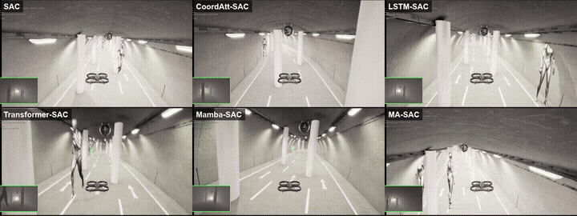
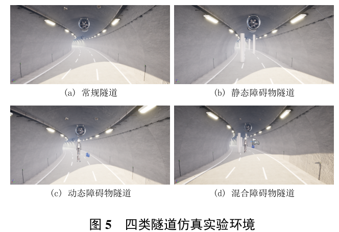
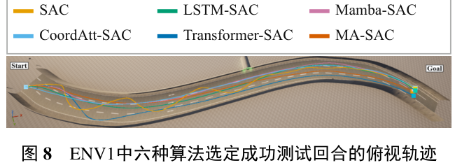
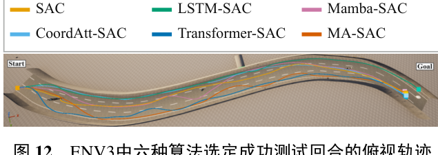
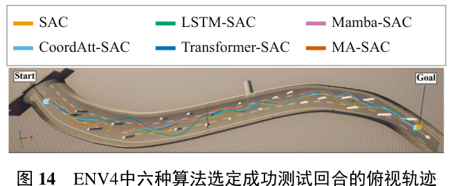
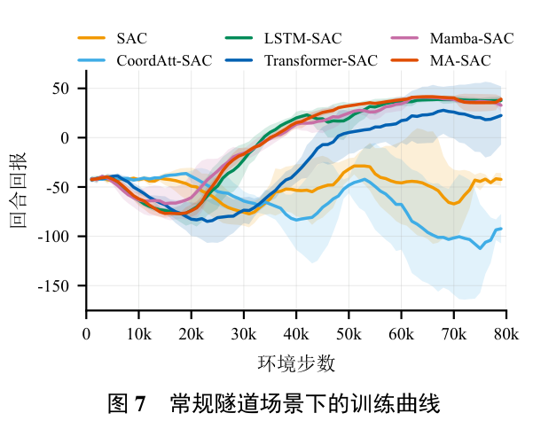
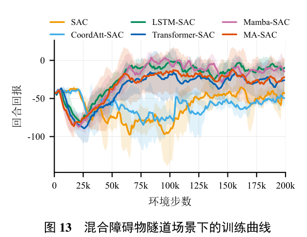
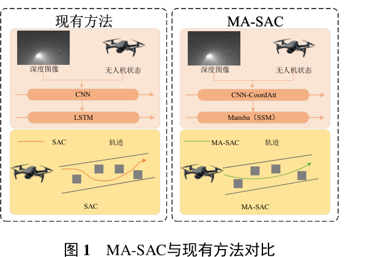

# UAVNav-Airsim

**Deep reinforcement learning for UAV visual obstacle avoidance in confined tunnels — Cosys-AirSim + Unreal Engine.**

面向隧道受限空间的无人机视觉避障：以单目深度图序列与机体状态为输入、三维速度指令为输出的端到端深度强化学习。仓库包含 MA-SAC 方法实现，以及 6 种 SAC 系算法在 4 类 UE4 隧道场景下的完整训练 / 评估 / 筛选流水线。



## 亮点

- **MA-SAC**：CoordAtt 对深度特征做方向感知重标定 + Mamba 选择性状态空间模型对历史观测做选择性记忆，作为 Actor/Critic 的时序主干
- 自建 **4 类 UE4 隧道场景**：常规 / 静态障碍 / 动态障碍 / 动静混合
- **6 算法 × 3 随机种子 × 100 回合**标准化评估；多 AirSim 实例 RPC 并行训练、checkpoint 自动筛选、评估 manifest 归档
- 论文《融合坐标注意力与选择性时序建模的无人机视觉避障方法》投稿《控制与决策》（EI 收录期刊），返修中



## 实验结果

### 成功回合俯视轨迹对比

| ENV1 常规 | ENV3 动态 | ENV4 混合 |
|---|---|---|
|  |  |  |

### 训练曲线（回合回报，3 种子均值 ± 标准差）

| ENV1 常规 | ENV4 混合 |
|---|---|
|  |  |

## 方法概述

- **问题建模**：隧道内重复截面与有限视场导致部分可观测，建模为 POMDP；观测为 60×90 深度图序列 + 无人机状态，动作为连续三维速度指令（前向速度 / 垂直速度 / 偏航角速度）
- **策略网络**：CNN + CoordAtt 编码深度图 → Mamba 时序主干（Actor 与 Critic 共用结构）→ 连续动作分布
- **训练机制**：面向不等长轨迹的序列化 SAC——特征缓存、掩码损失、分阶段梯度更新
- **对比基线**：SAC(FrameStack4) / CoordAtt-SAC / LSTM-SAC / Transformer-SAC / Mamba-SAC



## 仓库结构

```
configs/      各算法与场景的训练配置
gym_env/      Gymnasium 环境封装、网络结构、回放缓冲、wrappers
scripts/      训练编排 / 评估 / checkpoint 筛选 / 分析 / 打包入口
tests/        无仿真自检（仅依赖标准库）
docs/         架构说明：模块职责与训练→评估→筛选调用链
Logs/         训练与评估产物目录（见 Logs/README.md）
```

## 快速开始

```powershell
# Python 环境（pixi）
pixi install

# 训练（先 dry-run 看计划，确认后去掉 --dry-run）
pixi run python -m scripts.training.train_parallel --scene tunnel --dry-run

# 评估
pixi run python -m scripts.evaluation.evaluate_completed_runs --dry-run

# 训练曲线
tensorboard --logdir Logs/TrainData/Runs

# 无仿真自检（不需要 AirSim / GPU）
pixi run python -m unittest discover -s tests -t .
```

正式运行前请阅读 [`RETRAINING.md`](RETRAINING.md)：实验口径、训练预算与完成判定。

## 文档

- [`RETRAINING.md`](RETRAINING.md)：实验协议与一键命令
- [`docs/ARCHITECTURE.md`](docs/ARCHITECTURE.md)：模块职责与数据流
- [`scripts/README.md`](scripts/README.md)：脚本入口
- [`Logs/README.md`](Logs/README.md)：产物目录约定

## 引用

```bibtex
@article{zhao2025mambasac,
  title={融合坐标注意力与选择性时序建模的无人机视觉避障方法},
  author={王海涌 and 赵洪建 and 王孟琳 and 张丹 and 陆昱亨},
  journal={控制与决策},
  note={返修中},
  year={2025}
}
```
